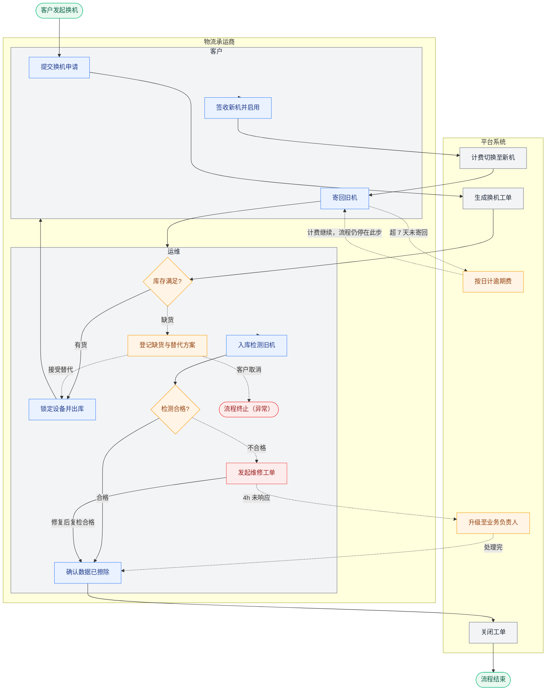

# 实例：换机与旧机回收跨角色泳道图

这是本技能的完整参考实现。业务场景：设备租赁客户申请换机，旧机回收入库、检测、擦除后闭环。

对应提示词：

```text
用 $product-diagram-generator，画一张【换机与旧机回收】跨角色泳道流程图。
角色：客户、运维、物流承运商、平台系统。
必须覆盖：正常换机链路（申请 → 出库 → 签收 → 寄回 → 检测 → 擦除 → 关单），
以及库存缺货、旧机逾期未寄回、检测不合格三条异常分支。
输出 Mermaid 源码 + 分层说明，另出一份可拖拽的 .drawio。
```

## 一、结构清单（Stage 1 产物）

```text
流程名：换机与旧机回收入库
触发：客户在控制台点击「申请换机」
结束：旧机检测合格并关闭工单 / 客户中途取消

角色：
  L1 客户
  L2 运维
  L3 物流承运商
  L4 平台系统

主干：
  1. 客户 → 提交换机申请 → 平台系统
  2. 平台系统 → 生成换机工单 → 运维
  3. 运维 → 锁定设备并出库 → 物流承运商
  4. 物流承运商 → 揽收并发货 → 客户
  5. 客户 → 签收新机并启用 → 平台系统
  6. 平台系统 → 计费切换至新机 → 客户
  7. 客户 → 寄回旧机 → 物流承运商
  8. 物流承运商 → 回运并签收 → 运维
  9. 运维 → 入库检测 → 运维
  10. 运维 → 确认数据已擦除 → 平台系统
  11. 平台系统 → 关闭工单 → 结束

异常：
  E1 触发：库存无可用设备
     处理方：运维
     结果：登记缺货与替代方案；客户接受替代则回到锁定出库，取消则流程终止
  E2 触发：签收后 7 天未寄回旧机
     处理方：平台系统
     结果：按日计逾期费，流程停在「寄回旧机」，不终止
  E3 触发：入库检测不合格
     处理方：运维 → 平台系统
     结果：发起维修工单；修复后复检合格回到擦除确认，4 小时未响应升级至业务负责人
```

## 二、Mermaid 源码（Stage 3 产物）



节点 20 个（上限 25），泳道 4 条，主干 1 条 + 异常 3 条。

## 三、分层说明（Stage 4 产物）

### 角色层

- **客户**：发起换机、签收、寄回旧机。不参与检测判定，也不决定缺货替代方案的内容。
- **运维**：受理、出库、入库检测，对「设备可交付」负最终责任。
- **物流承运商**：只负责运输与签收回执，不对设备状态负责，也不接触计费。
- **平台系统**：工单、计费、逾期计时、关单，对「钱和单据」负最终责任。

### 流程层

主干 11 步，5 个跨角色交接点：客户→平台、平台→运维、运维→物流、物流→客户、客户→物流（寄回）。

- E1 缺货从「库存校验」岔出：接受替代则**回流主干**，取消则终止，两条路都有出口。
- E2 逾期从「寄回旧机」岔出：**不终止也不回流**，流程停在原节点持续计费——这类「原地等待」的异常最容易被画成断头路，必须写清结果。
- E3 检测不合格从「入库检测」岔出：修复复检后**回到擦除确认**（重新入主干），升级路径处理完同样回到擦除确认。
- 无并行点：签收必须先于计费切换，检测必须先于擦除确认。

### 系统层

- **自动动作**：逾期计时由平台定时任务每日跑批；工单 4 小时响应计时自动触发升级。
- **人工动作**：入库检测需实物核验，由运维执行，不可自动化。
- **跨系统调用**：平台 → WMS 出库单，通过换机工单号同步触发；物流轨迹由承运商回调。
- **系统边界**：计费规则全部在平台侧计算，物流与仓储系统不接触金额。

### 边界与缺口

- **未覆盖**：多台设备同时换机时的库存抢占与锁定顺序。
- **未覆盖**：维修期间客户是否继续计费（图上按继续计费处理，待商务确认）。
- **待确认**：7 天寄回期限是否含节假日。
- **待确认**：旧机数据擦除失败时，合规责任由谁承担。

## 四、drawio 版本

同目录 `device-swap-swimlane.drawio`：4 条原生 swimlane 泳道，主干走 A 行、异常走 B 行，节点可拖拽精修。预览见 `device-swap-swimlane-preview.png`。

布局要点（对应 drawio-rules 第二节）：

- 主干 11 步占 15 列，列间距 60px（够放「有货」「缺货」这类 2~4 字标签），行间距 60px
- 异常节点放 B 行（泳道高度 230），不与主干抢走位
- 终态「流程终止」紧贴触发它的「登记缺货」左侧：若放进客户泳道，连线必须跨行上行，
  会被「库存满足?」正上方的出边与相邻连线夹死——终态跟着分支走，不做跨泳道长线
- 逾期这条「原地等待」异常用一对往返边表达：去程计费、回程继续等待，两条线用
  0.35/0.65 分位锚点分开，标签用 labelT 错开高度

> Mermaid 无原生 swimlane 语法，上面源码用 `subgraph` 模拟：泳道只能整块堆叠，同一角色无法在不同阶段出现两次。要严格泳道对齐用 drawio 版本。
