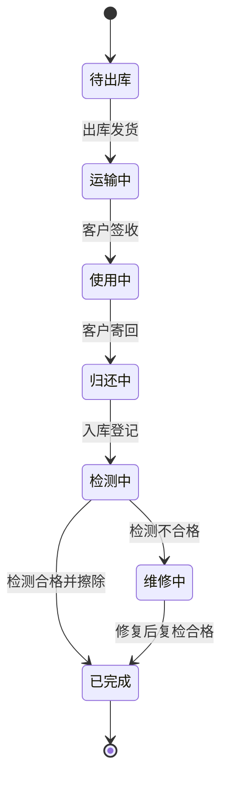

# 图型选型

同一段描述，选错图型会让评审会多开半小时。按下面的表选。

## 一、快速判断

| 描述里的特征 | 图型 | 产出语法 |
|---|---|---|
| 多个角色、有交接、有超时/驳回 | **跨角色泳道图** | `flowchart TD` + `subgraph` |
| 一串步骤、基本单角色 | 主干流程图 | `flowchart TD` |
| 单据在状态间流转、有触发事件 | 状态机图 | `stateDiagram-v2` |
| 强调系统间调用先后与返回 | 时序图 | `sequenceDiagram` |
| 强调由哪些层组成、谁依赖谁 | 分层架构图 | `.drawio`（层带 + 模块） |
| 要真泳道、要拖拽改 | 泳道图 + draw.io | `.drawio` |

## 二、泳道图 vs 主干流程图

**先问自己：图里有没有「交接」？**

- 有交接（A 做完交给 B）→ 泳道图。泳道的全部意义就是让交接点显形。
- 没交接（一个人从头做到尾）→ 主干流程图。硬套泳道只会把图撑宽。

角色数参考：

| 角色数 | 建议 |
|---|---|
| 1 | 不要泳道 |
| 2–4 | 泳道的最佳区间 |
| 5–6 | 可用，但考虑拆主图 + 子图 |
| >6 | 先问能否合并；合不了就拆图 |

## 三、流程图 vs 状态机图

口径：**看主语是「动作」还是「状态」。**

| 描述 | 图型 |
|---|---|
| 「运维入库检测，合格就擦除数据，不合格发维修工单」 | 流程图（主语是动作） |
| 「设备从 待出库 → 运输中 → 使用中 → 归还中 → 检测中 → 已完成，检测不合格回到维修中」 | 状态机（主语是状态） |

状态机必备四要素：

- 状态集合（每个状态写清进入条件）
- 触发事件（什么动作导致跃迁）
- 守卫条件（同一事件在不同条件下去向不同）
- 终态（哪些状态不再变化）



## 四、流程图 vs 时序图

| 关注点 | 图型 |
|---|---|
| 业务分支、异常路径 | 流程图 |
| 调用顺序、同步/异步、超时重试 | 时序图 |

时序图用在**系统对接评审**，流程图用在**业务逻辑评审**。可以同时出，但不要混成一张。

## 五、泳道图 vs 分层架构图

两者的横轴含义完全不同，别混：

- **泳道图**：横轴是流程推进，纵轴是角色。回答「谁在什么时候做什么」。
- **分层架构图**：横轴是功能域，纵轴是层级。回答「系统由哪几层组成、依赖往哪个方向走」。

## 六、分层架构图的两套层序

### 产品功能架构（PM 汇报用，推荐）

```text
L1 触点层          用户与运维看到的一切（页面、入口、终端）
L2 应用服务层      只做编排，不写规则
L3 核心业务域      业务规则的唯一归属地（订单域、设备域、计费域……）
L4 中台与集成层    外部系统与共享能力（WMS、物流、支付、消息）
L5 基础与数据层    不认识业务词的东西（库、流水、审计、调度）
```

五层的判别标准是**「规则归谁」**，不是「东西放在哪」：

- 有业务规则、会因业务变化而改 → L3
- 只负责把 A 的请求转给 B、拼装页面 → L2
- 是别人家的系统、或全公司共用 → L4
- 换成另一个业务也能原样用 → L5

### 技术架构（研发对齐用）

```text
接入层 → 应用层 → 领域服务层 → 数据层 → 基础设施层
```

两套都行，看听众。给业务方讲用前者，给研发讲用后者。**同一份材料别混用**，否则会出现「触点层 vs 接入层」对不上的尴尬。

### 依赖方向

架构图的依赖箭头**只能单向**（上层依赖下层）。出现反向依赖必须在图上标出并单独说明——那是架构异味，不是画错。

实际上大多数产品功能架构图**不画箭头**：层带自上而下堆叠，本身就是依赖方向。留白比画满更有说服力。

## 七、决策树

```text
有多个角色且有交接？
├─ 是 → 有超时/驳回/异常分支？
│        ├─ 是 → 跨角色泳道图（默认 Mermaid；要拖拽改则加 drawio）
│        └─ 否 → 泳道图（简版）
└─ 否 → 讲的是「系统分几层」？
         ├─ 是 → 分层架构图（drawio）
         └─ 否 → 描述的是状态流转？
                  ├─ 是 → 状态机图
                  └─ 否 → 强调系统调用先后？
                           ├─ 是 → 时序图
                           └─ 否 → 主干流程图
```

## 八、什么时候拆图

命中任一条就拆，不要硬塞：

- 节点总数 > 25
- 角色数 > 6
- 出现两个以上独立的起止对
- 主干长度 > 12 步

拆法：主图只留主干 + 关键异常，每条异常单独出子图，在主图上用节点标「详见子图 X」。
