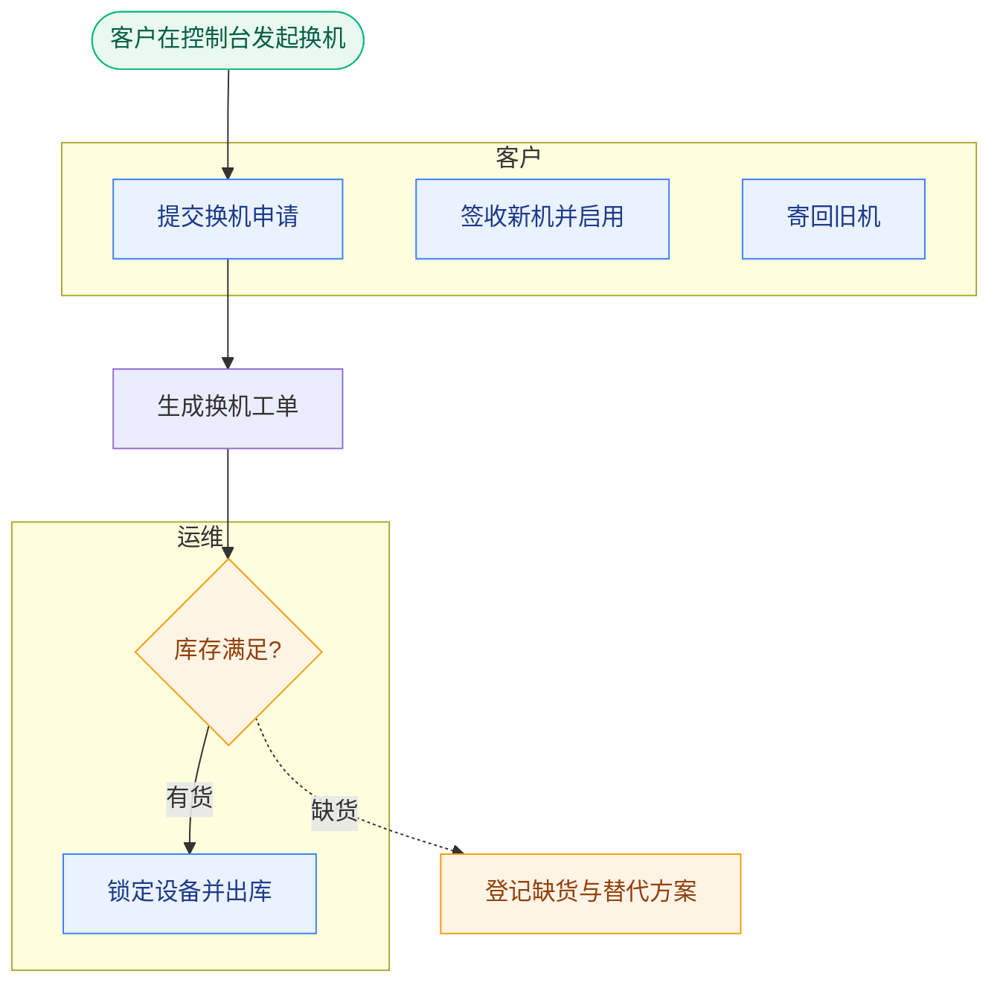

# Mermaid 语法规范

本文件是输出 Mermaid 时的唯一依据。目标：**贴进任何渲染器都能直接出图，能 diff，不报错。**

## 一、骨架

````markdown

````

## 二、硬性语法

### 1. ID 与标签分离

节点 ID **必须是 ASCII**：字母开头，只含字母、数字、下划线。

```text
✅ C1["提交换机申请"]      C1, O2, S1, L1
❌ 客户1["提交换机申请"]    中文 ID，部分渲染器直接报错
❌ 1C["提交换机申请"]       不能数字开头
```

中文、括号、标点全部写进标签。**ID 给机器看，标签给人看。**

### 2. 标签含特殊字符必须加引号

| 字符 | 例子 |
|---|---|
| `(` `)` | `C1["提交换机申请（7 天内）"]` |
| `[` `]` | `C1["订单[已支付]"]` |
| `{` `}` | `C1["字段{orderId}"]` |
| `、` `，` `:` | 中文标点密集时，统一加引号更稳 |
| `"` | 用 `#quot;` 转义 |

```text
✅ O4["检测合格?"]
❌ O4[检测合格?]
```

### 3. 形状

| 形状 | 语法 | 用途 |
|---|---|---|
| 矩形 | `C1["步骤"]` | 普通动作 |
| 圆角 | `C1("步骤")` | 一般处理 |
| 体育场形 | `Start(["开始/结束"])` | 起止 |
| 菱形 | `O1{"判断?"}` | 判断分支 |
| 圆形 | `J1(("汇合"))` | 汇合点 |

判断一律菱形 `{}`，起止一律体育场形 `([])`。

### 4. 连边

| 语义 | 语法 |
|---|---|
| 主干 | `C1 --> O1` |
| 主干带标签 | `O1 -->|"有货"| O2` |
| 异常 / 可选 | `O1 -.->|"缺货"| O5` |
| 强调异常 | `O1 ==> O5` |

**虚线只给异常和可选路径。** 主干全实线，否则一眼看不出哪条是正常路径。

### 5. subgraph 泳道

```text
subgraph L1["客户"]
    direction LR
    C1["提交换机申请"]
end
```

- `subgraph` 的 ID 用 ASCII，泳道名写中括号里并加引号
- 每个 `subgraph` 必须有对应 `end`。**配平是最高频的渲染失败原因**
- `direction LR` 可选，用于泳道内横向排列。嵌套 `direction` 部分渲染器不生效，别依赖它
- 别把节点写在外面又用 `class` 指进泳道

### 6. 语义配色

固定五组，含义不要串：

```text
classDef start fill:#E9F9EF,stroke:#10B981,color:#065F46   // 起止、成功结果
classDef role  fill:#EAF2FF,stroke:#3B82F6,color:#1E3A8A   // 角色动作
classDef sys   fill:#F3F4F6,stroke:#6B7280,color:#1F2937   // 系统/后台
classDef warn  fill:#FFF4E5,stroke:#F59E0B,color:#92400E   // 异常、超时、待判断
classDef risk  fill:#FDECEC,stroke:#EF4444,color:#991B1B   // 失败、拒收、终止
```

用法：`class C1,C2 role`，多个 ID 逗号分隔。

**不要随机配色。** 颜色必须承担语义，否则读者会去找规律，然后找不到。

### 7. 注释

```text
%% 注释不会渲染
```

只用于标注分区，不写成长段落。

## 三、禁用写法

| 禁用 | 原因 | 替代 |
|---|---|---|
| 中文 ID | 部分渲染器解析失败 | ASCII ID + 中文标签 |
| 标签内裸括号 | 语法歧义 | 整体加双引号 |
| 漏写 `end` | 整图渲染失败 | 写完立刻跑自检 |
| ID 撞关键字（`end` `graph` `subgraph` `class` `style` `linkStyle` `default` `direction`） | 解析冲突 | 加前缀，如 `E1` |
| 同一 ID 定义两次且标签不同 | 后定义覆盖，行为不确定 | 一个节点只定义一次 |
| 无引号标签里出现 `--` | 被解析成连边 | 加引号 |
| 混用 `flowchart` 与 `graph` | 方向语义不一致 | 统一 `flowchart` |
| 长句塞进节点 | 文字溢出 | ≤18 汉字，细节移入分层说明 |

## 四、布局方向

| 写法 | 效果 | 适用 |
|---|---|---|
| `flowchart TD` | 泳道上下堆叠，主干自上而下 | **默认**，最接近跨职能泳道观感 |
| `flowchart LR` | 泳道左右并列，主干自左而右 | 角色少（2–3）、强调左右交接 |
| `flowchart TB` | 同 `TD` | 同 `TD` |

不确定就用 `TD`。

## 五、自检

```bash
python3 scripts/check_mermaid.py path/to/diagram.mmd
python3 scripts/check_mermaid.py path/to/example.md   # 自动抽取 mermaid 代码块
```

脚本查这些：

- `subgraph` 与 `end` 是否配平
- 节点 ID 是否合法、是否撞关键字
- 标签是否含未加引号的裸括号
- 是否有孤岛节点（无入边）与死节点（有定义、无连边）
- 节点数是否超过 25

**退出码**：`0` 全绿，`1` 有错误，`2` 只有警告。有错误不要交付；只有警告也看一眼，多半是真问题。
